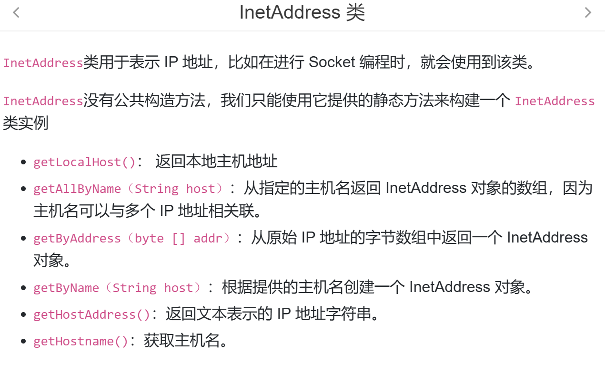

# JavaCodeBase

[TOC]

## 1. [String] 删去字符串中的某个字符

**法1：使用replace()方法**
```Java
import java.util.Scanner;

public class StringUtil{
    public static void main(String[] args) {
        Scanner scanner = new Scanner(System.in);
        String input = scanner.nextLine();
    
        String result = input.replace(" ", "");
        System.out.println(result);
        scanner.close();
    }   
}
```

**法2：使用for循环检查字符串**
```Java
import java.util.Scanner;  
public class StringUtil {  
    public static void main(String[] args) {  
        Scanner in =new Scanner(System.in);  
        //获取String值  
        String a=in.nextLine();  
        StringBuilder stringBuilder = new StringBuilder(a);  
        for (int i = 0; i < stringBuilder.length(); i++) {  
            if (stringBuilder.charAt(i)==' ') {  
                stringBuilder.deleteCharAt(i);  
                i--;  
            }  
        }  
        System.out.println(stringBuilder.toString());  
    }  
}  
```

## 2. [String]比较字符串是否一致
**法1:使用equal()方法**
```Java
import java.util.Scanner;

public class ContrastString2 {
    public static void main(String[] args) {
        Scanner scanner = new Scanner(System.in);
        String a = scanner.nextLine();
        String b = scanner.nextLine();
        if(a.equals(b)){
            System.out.println("相同");
        }else{
            System.out.println("不相同");
        }
        scanner.close();
    }
}

```

**法2:使用for循环比较字符串的每一位**
```Java
import java.util.Scanner;
public class ContrastString {
    public static void main(String[] args) {
        Scanner scanner = new Scanner(System.in);
        String a = scanner.nextLine();
        String b = scanner.nextLine();
        boolean isSame = true;
        if (a.length() != b.length()){
            isSame = false;
        }else{
            for(int i=0;i<a.length();i++){
                if (a.charAt(i)!= b.charAt(i)) {
                    isSame = false;
                    break;                    
                }
            }
        }
        if(isSame){
            System.out.println("相同");
        }else{
            System.out.println("不相同");
        }
        scanner.close();
    }
}
```

## 3. [Arrays]Arrays类常用方法

| 方法签名 | 功能描述 | 代码示例 |
| :--- | :--- | :--- |
| `<T> List<T> asList(T... a)` | 将指定的数组转换为固定长度的 `List` 集合 | `List<String> list = Arrays.asList("A", "B", "C");` |
| `void sort(Object[] a)` | 对指定的对象数组按照升序进行排列 | `Arrays.sort(arr);` |
| `void fill(Object[] a, Object val)` | 将指定对象引用赋值给指定数组的所有元素 | `Arrays.fill(arr, "DefaultValue");` |
| `boolean equals(Object[] a, Object[] a2)` | 如果两个指定数组彼此相等，则返回 `true` | `boolean isSame = Arrays.equals(arr1, arr2);` |
| `int binarySearch(Object[] a, Object key)` | 使用二分搜索法对已排序的数组进行搜索 | `int index = Arrays.binarySearch(arr, "Key");` |

>补充说明
> - 关于 asList：返回的 List 是由原数组 backed（支持）的，这意味着修改 List 中的元素会同步修改原数组，且该 List 的长度是固定的，不能进行 add 或 remove 操作。
> - 关于 sort：对于对象数组，它使用的是经过优化的归并排序（或 TimSort），保证了排序的稳定性。
> - 关于 binarySearch：在使用此方法之前，必须先对数组进行排序（调用 sort()），否则结果是不确定的。如果找不到元素，它通常返回一个负数。

## 4. [StringBuilder]StringBuilder类常用方法
| 方法名 | 功能描述 | 代码示例 |
| :--- | :--- | :--- |
| `append()` | 追加：在末尾添加内容 | `sb.append("Java")` |
| `insert()` | 插入：在指定位置插入内容 | `sb.insert(0, "Hello ")` |
| `delete()` | 删除：删除指定范围的字符 | `sb.delete(0, 1)` |
| `replace()` | 替换：替换指定范围的字符 | `sb.replace(0, 5, "World")` |
| `reverse()` | 反转：将字符串倒序 | `sb.reverse()` |
| `toString()` | 转换：变回普通的 String | `String s = sb.toString()` |
| `length()` | 长度：获取字符个数 | `int len = sb.length()` |<websource>source_group_web_6</websource>|

样例:
```Java 
public class StringBuilderDemo {
    public static void main(String[] args) {
        // 1. 创建 StringBuilder 对象
        // 可以传入初始字符串，也可以 new StringBuilder() 创建空的
        StringBuilder sb = new StringBuilder("Hello");

        // 2. append() - 追加内容 (最常用)
        sb.append(" World"); 
        sb.append("!");
        // 当前内容: "Hello World!"

        // 3. insert() - 插入内容
        // 在索引 5 的位置（即 "Hello" 后面）插入逗号
        sb.insert(5, ",");
        // 当前内容: "Hello, World!"

        // 4. replace() - 替换内容
        // 将索引 0 到 5 的内容（"Hello,"）替换为 "Hi"
        sb.replace(0, 6, "Hi");
        // 当前内容: "Hi World!"

        // 5. delete() - 删除内容
        // 删除索引 2 到 4 的内容（" Wo"）
        sb.delete(2, 5);
        // 当前内容: "Hild!"

        // 6. reverse() - 反转字符串
        sb.reverse();
        // 当前内容: "!dliH"

        // 7. length() - 获取长度
        System.out.println("当前长度: " + sb.length()); 

        // 8. toString() - 转换为 String
        // 当需要把结果赋值给 String 变量时，必须调用此方法
        String result = sb.toString();
        
        System.out.println("最终结果: " + result);
    }
}
```

## 5. [Calendar] Calendar类常用方法

| 方法名 | 功能描述 | 代码示例 |
| :--- | :--- | :--- |
| `getInstance()` | 获取当前系统时间的 Calendar 单例对象 | `Calendar cal = Calendar.getInstance();` |
| `get(int field)` | 获取指定时间字段（年 / 月 / 日 / 时 / 分 / 秒） | `int year = cal.get(Calendar.YEAR);` |
| `set(int field, int value)` | 单独设置某个时间字段 | `cal.set(Calendar.HOUR, 10);` |
| `set(int y, int m, int d)` | 快速设置年月日 | `cal.set(2026, 4, 5);` |
| `add(int field, int amount)` | 时间增减运算（加 / 减天、月、年） | `cal.add(Calendar.DATE, 3);` |
| `getTime()` | Calendar 转为 Date 对象 | `Date date = cal.getTime();` |
| `setTime(Date date)` | 用 Date 对象赋值给 Calendar | `cal.setTime(new Date());` |
| `getTimeInMillis()` | 获取毫秒级时间戳 | `long time = cal.getTimeInMillis();` |
| `setTimeInMillis(long)` | 通过时间戳设置时间 | `cal.setTimeInMillis(System.currentTimeMillis());` |
| `getActualMaximum(int)` | 获取字段最大值（当月最大天数 / 最大月份） | `int maxDay = cal.getActualMaximum(Calendar.DAY_OF_MONTH);` |

```Java
import java.text.DateFormat;
import java.text.SimpleDateFormat;
import java.util.Calendar;
import java.util.Date;

public class CalendarExample {
    public static void main(String[] args) {
        System.out.println("完整显示日期时间：");
        // 字符串转换日期格式
        DateFormat fdate = new SimpleDateFormat("yyyy-MM-dd HH:mm:ss");
        String str = fdate.format(new Date());
        System.out.println(str);

        // 创建 Calendar 对象
        Calendar calendar = Calendar.getInstance();
        // 初始化 Calendar 对象，但并不必要，除非需要重置时间
        calendar.setTime(new Date());

        // 显示年份
        System.out.println("年： " + calendar.get(Calendar.YEAR));

        // 显示月份 (从0开始, 实际显示要加一)
        System.out.println("月： " + calendar.get(Calendar.MONTH));


        // 当前分钟数
        System.out.println("分钟： " + calendar.get(Calendar.MINUTE));

        // 今年的第 N 天
        System.out.println("今年的第 " + calendar.get(Calendar.DAY_OF_YEAR) + "天");

        // 本月第 N 天
        System.out.println("本月的第 " + calendar.get(Calendar.DAY_OF_MONTH) + "天");

        // 3小时以后
        calendar.add(Calendar.HOUR_OF_DAY, 3);
        System.out.println("三小时以后的时间： " + calendar.getTime());
        // 格式化显示
        str = (new SimpleDateFormat("yyyy-MM-dd HH:mm:ss:SS")).format(calendar.getTime());
        System.out.println(str);

        // 重置 Calendar 显示当前时间
        calendar.setTime(new Date());
        str = (new SimpleDateFormat("yyyy-MM-dd HH:mm:ss:SS")).format(calendar.getTime());
        System.out.println(str);

        // 创建一个 Calendar 用于比较时间
        Calendar calendarNew = Calendar.getInstance();

        // 设定为 5 小时以前，后者大，显示 -1
        calendarNew.add(Calendar.HOUR, -5);
        System.out.println("时间比较：" + calendarNew.compareTo(calendar));

        // 设定7小时以后，前者大，显示 1
        calendarNew.add(Calendar.HOUR, +7);
        System.out.println("时间比较：" + calendarNew.compareTo(calendar));

        // 退回 2 小时，时间相同，显示0
        calendarNew.add(Calendar.HOUR, -2);
        System.out.println("时间比较：" + calendarNew.compareTo(calendar));

        // calendarNew创建时间点
        System.out.println((new SimpleDateFormat("yyyy-MM-dd HH:mm:ss:SS")).format(calendarNew.getTime()));
        // calendar创建时间点
        System.out.println((new SimpleDateFormat("yyyy-MM-dd HH:mm:ss:SS")).format(calendar.getTime()));
        System.out.println("时间比较：" + calendarNew.compareTo(calendar));
    }
}
```

## 6. [IOStream] IO文件读写范例
```Java 
import java.io.File;
import java.io.FileInputStream;
import java.io.FileNotFoundException;
import java.io.FileOutputStream;
import java.io.IOException;


public class FileIOStreamExample{
    public static void main(String[] args) {
        try {
            File inFile = new File("file.txt");
            File outFile = new File("file_copy.txt");
            FileInputStream fis = new FileInputStream(inFile);
            FileOutputStream fos = new FileOutputStream(outFile);
            int c;
            while((c = fis.read()) != -1){
                fos.write(c);
            }
            fis.close();
            fos.close();
        } catch (FileNotFoundException  e) {
            System.out.println("FileStreamsTest:" + e);
        } catch (IOException e){
            System.err.println("FileStreamTest:" + e);
        }
    }
}
```

## 7. [IOStream] 二进制文件读写

方法1. 使用字符数组缓冲（标准写法、高效）
```Java
import java.io.FileInputStream;
import java.io.FileOutputStream;
import java.io.IOException;

public class BinaryCopy {
    public static void main(String[] args) {
        String srcPath = "test.zip";
        String destPath = "copy.zip";

        // 缓冲区：一般 1024*8 = 8KB
        byte[] buffer = new byte[1024 * 8];

        try (FileInputStream fis = new FileInputStream(srcPath);
             FileOutputStream fos = new FileOutputStream(destPath)) {

            int len;
            // len：本次实际读到的字节数
            while ((len = fis.read(buffer)) != -1) {
                // 只写有效字节，避免多余空字节
                fos.write(buffer, 0, len);
            }
            System.out.println("复制成功");
        } catch (IOException e) {
            e.printStackTrace();
        }
    }
}
```

方法2. 使用Buffered包装（效率高）
```Java
import java.io.BufferedInputStream;
import java.io.BufferedOutputStream;
import java.io.FileInputStream;
import java.io.FileOutputStream;
import java.io.IOException;

public class BufferedBinaryIO {
    public static void main(String[] args) {
        try (BufferedInputStream bis = new BufferedInputStream(new FileInputStream("video.mp4"));
             BufferedOutputStream bos = new BufferedOutputStream(new FileOutputStream("video_copy.mp4"))) {

            byte[] buf = new byte[1024 * 8];
            int len;
            while ((len = bis.read(buf)) != -1) {
                bos.write(buf, 0, len);
            }
            // 强制刷新缓冲区，确保数据全部写出
            bos.flush();
            System.out.println("二进制文件读写完成");
        } catch (IOException e) {
            e.printStackTrace();
        }
    }
}
```

## 8. [HttpURL] HttpURL请求
``` Java
import java.io.BufferedReader;
import java.io.IOException;
import java.io.InputStream;
import java.io.InputStreamReader;
import java.net.HttpURLConnection;
import java.net.URL;

public class HttpUrlTest {
    public static void main(String[] args) {
        try {
            //设置url
            URL shiyanlou = new URL("https://www.lanqiao.cn");
            //打开连接
            HttpURLConnection urlConnection = (HttpURLConnection)shiyanlou.openConnection();
            //设置请求方法
            urlConnection.setRequestMethod("GET");
            //设置连接超时时间
            urlConnection.setConnectTimeout(1000);
            //获取输入流
            InputStream inputStream = urlConnection.getInputStream();
            BufferedReader bufferedReader = new BufferedReader(new InputStreamReader(inputStream));
            //打印结果
            bufferedReader.lines().forEach(System.out::println);
            //关闭连接
            inputStream.close();
            bufferedReader.close();
            urlConnection.disconnect();
        } catch (IOException e) {
            e.printStackTrace();
        }
    }
}
```

## 9. [InetAddress] InetAddress类常用方法


```Java
import java.net.InetAddress;
import java.net.UnknownHostException;

public class InetAddressDemo {
    public static void main(String[] args) {
        try {
            InetAddress shiyanlou = InetAddress.getByName("www.lanqiao.cn");
            //toString 方法将输出主机名和ip地址
            System.out.println(shiyanlou.toString());
            //获取ip地址
            String ip = shiyanlou.toString().split("/")[1];
            //根据IP地址获取主机名
            InetAddress byAddress = InetAddress.getByName(ip);
            System.out.println("get hostname by IP address:" + byAddress.getHostName());
            System.out.println("localhost: "+InetAddress.getLocalHost());
        } catch (UnknownHostException e) {
            e.printStackTrace();
        }
    }
}
```
```Bash
www.lanqiao.cn/121.40.227.60
get hostname by IP address:www.shiyanlou.com
localhost: 90ce6f59cfd6/192.168.42.3
```


## 10. 线程池的三种提交任务的方法

三种方式：
1. `execute(自定义Runnable类)` 无返回值
2. `submit(Lambda Runnable)` 无返回值，可获取Future
3. `submit(Callable)` 有返回值，能拿到执行结果

```java
import java.util.concurrent.Callable;
import java.util.concurrent.ExecutorService;
import java.util.concurrent.Executors;
import java.util.concurrent.Future;

// 方式1：自定义Runnable任务类
class MyTask implements Runnable {
    private final int taskId;

    public MyTask(int taskId) {
        this.taskId = taskId;
    }

    @Override
    public void run() {
        System.out.println("【自定义Runnable】线程:" + Thread.currentThread().getName()
                + "，执行任务ID：" + taskId);
        try {
            Thread.sleep(300);
        } catch (InterruptedException e) {
            e.printStackTrace();
        }
    }
}

public class PoolSubmitDemo {
    public static void main(String[] args) throws Exception {
        // 创建固定2线程池
        ExecutorService pool = Executors.newFixedThreadPool(2);

        // ========== 方式1：execute 提交自定义Runnable对象（无返回值） ==========
        for (int i = 1; i <= 2; i++) {
            pool.execute(new MyTask(i));
        }

        // ========== 方式2：submit 提交Lambda Runnable（无返回，可获取Future） ==========
        Future<?> future1 = pool.submit(() -> {
            System.out.println("【Lambda Runnable】线程:" + Thread.currentThread().getName() + " 执行");
            Thread.sleep(300);
        });
        System.out.println("Lambda任务是否完成：" + future1.isDone());

        // ========== 方式3：submit 提交Callable（带返回值） ==========
        Callable<Integer> callTask = () -> {
            int sum = 0;
            for (int i = 1; i <= 10; i++) sum += i;
            Thread.sleep(300);
            return sum;
        };
        Future<Integer> future2 = pool.submit(callTask);
        // get()阻塞获取返回结果
        Integer result = future2.get();
        System.out.println("【Callable返回值】1~10求和 = " + result);


        // 关闭线程池
        pool.shutdown();
    }
}
```

三种方式区分总结
1. **`pool.execute(new MyTask(id))`**
   - 参数：实现 `Runnable` 的自定义类
   - 无返回值，无法获取任务结果
   - 适合需要复用、携带多个参数的复杂任务

2. **`pool.submit(() -> { ... })`**
   - 参数：Lambda 表达式（匿名Runnable）
   - 返回 `Future<?>`，可判断任务是否完成，但拿不到业务返回值
   - 适合简单、一次性短任务，代码简洁

3. **`pool.submit(new Callable<>(){})`**
   - 参数：`Callable` 对象
   - 返回 `Future<T>`，调用 `.get()` 能拿到线程执行返回的数据
   - 适合需要计算、需要获取执行结果的场景

## 11. Future的两种使用方法
```Java
import java.util.concurrent.Callable;
import java.util.concurrent.ExecutorService;
import java.util.concurrent.Executors;
import java.util.concurrent.Future;

public class FutureDemo {
    public static void main(String[] args) throws Exception {
        // 创建单线程池
        ExecutorService pool = Executors.newSingleThreadExecutor();

        // 定义带返回值的Callable任务
        Callable<Integer> task = () -> {
            System.out.println("子线程开始计算...");
            Thread.sleep(2000); // 模拟耗时计算2秒
            return 1 + 99;
        };

        // 提交任务，立刻返回Future凭证，主线程不会阻塞
        Future<Integer> future = pool.submit(task);

        System.out.println("主线程继续执行其他业务，不阻塞");

        // 1. isDone()：非阻塞，轮询判断任务是否完成
        while (!future.isDone()) {
            System.out.println("任务还未执行完毕，等待中...");
            Thread.sleep(300);
        }
        System.out.println("检测到任务执行完成，准备获取结果");

        // 2. get()：阻塞方法，获取子线程返回值
        Integer result = future.get();
        System.out.println("子线程计算结果：" + result);

        pool.shutdown();
    }
}
```
### 运行逻辑说明
1. `pool.submit(task)` 提交任务后马上得到 `Future`，主线程可以继续往下走；
2. `future.isDone()` 不会阻塞线程，只是单纯查询任务状态，返回 `true/false`；
3. 循环持续检测，直到任务跑完跳出循环；
4. `future.get()` 阻塞获取返回值，此时任务已经完成，会立刻拿到结果，不会长时间等待。
