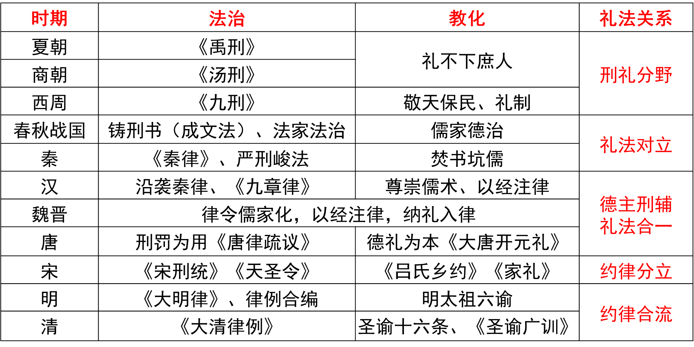
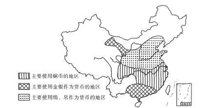
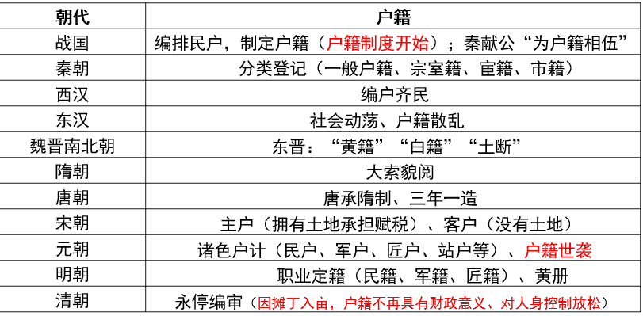
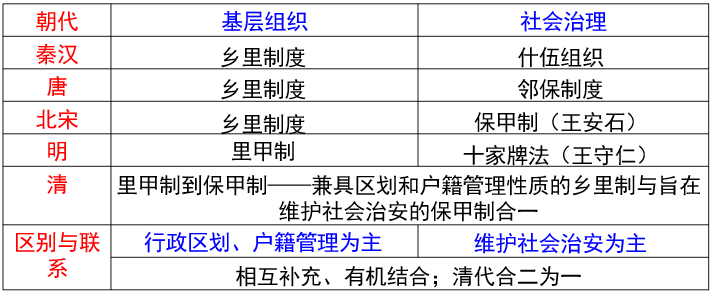

# 高中历史命题密码--古代史中国篇

[TOC]

## 精耕细作

**目的:提高单产（单位面积土地产出更多粮食）**
- 生产工具：木石骨蚌农具、铁犁牛耕、曲辕犁；
- 水利工程：都江堰、龙首渠；
- 水利工具：翻车、高转筒车；
- 耕作方法：垄作法、稻麦套作、熟制、间作套种；
- 农业技术类：生产工具、水利、育种技术；
- 因地制宜（地形）和因时制宜（节气）
- 农学农书的总结

### 例题
（2021湖南）5.宋孝宗时绍兴府赈灾，有人户状告检放秋苗不尽不实”。朱熹受命调查后发现确实存在不实，但是当时田土大多已经种麦，没有稻根可据以核查受灾面积。这反映了
A.绍兴府行政效率低下
B.理学强调实事求是的精神
C.宋代赈灾方式不合理
**D.绍兴农业精耕细作的特点**
**【答案】D**

## 商品经济
内涵定义： 自然经济:自给自足 VS 商品经济：交换（交换包括以物易物/货币媒介）

外延：
**农业方面**
- 物种交流
- 土特产交换逻辑
- 高产作物满足本地消费需要后面向外地市场
- 高产作物粮食种植面积提高和经济作物种植面积比例调整 -> 经济作物增多，农业商品化种植的程度提高

**商业方面**
- 货币、信贷、金融、贸易、契约
- 商帮、坊市制度、经济作物、农产品手工产品商业化、工商业市镇
- 重农抑商政策的放松（榷场互市、边贸）
- 白银货币化（流通）->实物税转为货币税（一条鞭法）

**法律方面**
民法（罗马法） -> 解决商业类纠纷 ->推动商品经济发展

**交通运输方面**
- 丝绸之路、新航路开辟
- 交通工具革新
- 度量衡、车轨统一（国内市场统一）

**现代**
经济全球化、世贸组织、国际货币基金组织（汇率稳定）

**其他表现**
- 西方庄园经济解体
- 中国近代以来自然经济解体（耕织分离等标志）
- 士农工商四民阶级的变动（社会流动、工商皆本思想、商人地位的提高）
- 雇佣关系、募役法、劳力服务
- 债权股权
- 资本主义萌芽、商品加工的分工生产

**土地的自由买卖并不是体现商品经济的表现 因为这并没有打破自然经济（自给自足）只是内部交换**

### 课本内容

**选必二**
不同物种的交流推动了当地经济和贸易的发展。在北美，水稻除供应本地消费外，大量用于出口，促进了对外贸易的发展。在中国，玉米等外来农作物因其高产而增加了粮食供应总量。粮食除满足生产者白身需要外，还投人市场出售，促进了**商品经济**的发展。

人类社会的商贸活动最初只是地方性行为，后扩大到国与国、洲与洲之间。丝绸之路是连接亚、欧、北非的商贸通道。货币、信贷、商业契约的出现，**是商品经济发达的表现**，便利了商品交换，扩展了商贸活动的领域。新航路开辟后，随着资本主义在全球的扩张，世界市场逐步形成。商贸活动的内容、形式都发牛了巨大变化。20世纪以来，贸易、金融现代化加速，极大地提高了商贸效率，但也增大了金融风险。


在古代中国，交换物品的场所称作“市”，通常设在人们经常集聚的地方。商朝就已经出现了专门从事**商品交换**的商人，商业贸易遍及商朝统治区城和周边地区，商业主要掌握在官府和贵展手里。春秋战国时期，“工商食官”的格局被突破。秦汉时期，货币、车轨、度量衡的统一，**促进了全国的商品流通**。从隋唐到两宋，随着商品经济的发展，城市坊市分区制度逐步瓦解，商业进一步繁荣。元、明、清时期，随着经济作物种植面积扩大和手工业的发展，农产品和手工业产品的商品化程度不断加深，形成全国范围的商业贸易网络，地域性的商人群体——商帮兴盛。(P36)

## 重农抑商政策

**历程**
**商鞅变法**    开始
**秦以后**  历代都推行
**汉初**    促进经济恢复（重农抑商）
**唐中后期两宋**   政策松动观念松动
**明清**    官方加强    
民间观念松动（民间贱商观念松动、求富观念兴起、婚姻求富观念“婚姻不问阀阅”）
**清末马关条约**    结束(放宽民间设厂限制) 清末新政（鼓励工商

**政策**
- 商业重税、限制消费、商人不得乘车，不得穿丝绸
- 商人子弟不得科举入仕
- 坊市制、盐铁专营
- 四民阶级观念、贱商观念


## 商人地位
四民地位：士农工商
商人民间地位提高（唐宋以后）
商人政治地位一直很低（官方观念不变）
商人地位有所变动（甲午中日战争后、清末新政后）

## 士农工商四民地位

1. **春秋时期：** 管仲在齐国进行变法改革时提出了“士农工商四民者”的概念，将国民分为军士、农民、工匠、商贾，没有尊卑之分

2. 尊卑之分：**秦汉（秦国）**
士最尊贵
农民次之
商人卑贱（重农抑商）不是主要剥削对象，财富资本集中壮大威胁统治

3. 士的变化：
- 春秋战国，士大夫阶层崛起、活跃
- 政治：秦朝郡县制取代分封制、军功爵制取代世卿世禄制，官僚体制确立（皇帝垂直任免各级官
吏；官僚职业化）一军士演化为官僚
- 经济：铁犁牛耕，新兴地主崛起一士阶层基本都为地主
- 文化：汉武帝尊崇儒术、汉代察举制征辟制，读书人地位的提高、士阶层的融合发展

4. 士农工商：四民结构（中国古代社会结构）、阶层之分/阶层分化/阶层流动 **（宋代发展）**
> 四民内部还可以有阶层的划分：
> - 士阶层内部士族阶层和寒门不同
> - 四民先分尊卑；
> - 士阶层内部再分尊卑：皇族亲族、士族·短暂、爵位、官员品阶

5. **清末：** 四民结构开始解体
资产阶级、无产阶级兴起
绅商阶级：地主和资产阶级混通
买办阶级：依附于列强，作为列强侵略的代理人的特殊阶级

6. **新中国：** 人人平等，四民阶级彻底解体

## 市民阶层和市民文化


## 中央集权和君主专制
先秦（秦朝以前）没有中央集权和君主专制（例外：秦国）；秦以后才有

- 中央集权：中央和地方关系（政策/措施在地方）；
- 君主专制：皇权和相权（政策/措施在中央）

中央地方别称：强干弱枝、外重内轻：干、内：中央；枝、外：地方

## 宗族/宗族观念

**历程**
1. 原始社会产生（ **父系氏族** ）
2. 商周与分封制宗法制结合（ **王侯宗族** ）
3. 宋代形成宗族制度（ **官员宗族** 、家训、家规）
4. 明清成熟（ **平民宗族** ）

**特点**
1. 以血缘为基础
2. 在家庭的基础上，以”宗“统”族“
3. 有祠堂、族长、族谱、族田等要素
4. 有社会救济的功能
5. 依附于皇权（皇权在乡村的代理人）->皇权不下县
6. 顺应忠孝伦理等主流意识
7. 自治性（有权处理内部事务）

**作用**
辅助地方官员政权，是维持地方秩序的非官方组织

## 郡国并行制

**时间**：汉初——汉武帝时期
汉武帝实行推恩令--郡国并行制名存实亡

**实行郡国并行制的原因**
历史遗留问题：异姓诸侯王、反秦起义的正义性
分封制在王朝前期有巩固新生政权作用

**恢复郡县的手段：** 剪除异性诸侯王（汉高祖）、军事平定（汉景帝）、废王侯将相或暂管、推恩令（汉武帝）、酎金夺爵、经济手段（自铸币，收回铸币权、盐铁专营权）

**分封和郡县的核心不同** 任期；向下分封；继承

## 藩镇

**历程**
**唐代 安史之乱前：**
玄宗开元年间在边境设置军镇和节度使
> 为巩固边疆，在北方、西北设置节度使，掌管数州军事，初期仅为军事防御机构，受中央严格节制

玄宗后期（唐朝中期）外重内轻

**唐代 安史之乱后：**
内地增设藩镇，节度使藩镇坐大，形成藩镇割据。

> 唐朝为平定叛乱，被迫扩大地方节度使权限，允许其自行募兵、征税以应对战乱。叛乱平定后，藩镇数量激增（全国达 40 余处），其中河北、山东等地的 “河朔三镇”（幽州、成德、魏博）率先形成割据，成为 “藩镇割据” 的典型。）

**唐朝灭亡后**
唐朝灭亡后，五代十国的割据政权多由藩镇演变而来
> 如后梁建立者朱温曾任宣武军节度使

**特点**
**职权合一**：节度使（藩镇最高长官）掌握地方军事、行政、财政、司法等核心权力
>“既有其土地，又有其人民，又有其甲兵，又有其财赋”（《新唐书》），形成 “军政财一体化” 的割据基础。

**人事自主：** 可自行任免下属官员，甚至父子相承或部将拥立
> 如 “河朔三镇” 节度使多为世袭，中央难以干预。

**军事割据：** 拥有独立武装（“牙兵”），兵力远超中央直接控制的军队，甚至公然对抗中央政令
> 如唐朝后期藩镇 “不输贡赋”“不入朝”。

**区域分异：** 并非所有藩镇都割据，唐朝藩镇可分为 “割据型”（如河朔三镇）、“防御型”（边疆抵御吐蕃等）、“财源型”（东南供应中央财赋），但 “割据型” 是导致中央失控的核心。*全国卷*

军权吞噬地方行政权（节度役使州县）

**地域** 
- 边疆中原割据严重（中央采取藩镇互相制衡）
- 东南、南方、四川相对稳定（中央控制力强）
- 四川战略地位提高（藩镇割据问题、吐蕃崛起）


## 刺史

中央斗地方：中央派遣官员监察
汉武帝设置13州刺史，巡查地方官员和豪强地主
地位：以卑临尊

**历程**
**前期：** 加强中央集权
**后期：** 监察权吞噬行政权一监察长官转为行政长官；监察区转为行政区（削弱中央集权）
**东汉晚期** 州正式成为一级行政机构，州郡县三级制，刺史行政权+领兵权
**东汉末：** 豪强一士族+地方官员•州牧+武人集团（小军阀）

## 中国古代人身关系

被控制者/控制对象：农民
控制者：国家
控制农民的原因：农民是税源
国家控制人民的方式：户籍制度/限制人口地域流动 + 阶级/职业流动
国家对农民的人身控制逐渐放松：赋税制度变化（人丁税变成田地税为主）
放松的标准：两税法

人身依附的制度：
1. **奴籍制度**：中国古代有奴籍（贱民阶层）和自由人之分
宋代  贱民阶层显著减少--社会成员趋于平等
（科举--门阀衰落/贱民阶层/商人的栓会地位提高）
家内服役：前代世袭奴婢（依附主家），宋代开始变成雇佣关系（文化称呼）

2. **租佃关系**：地主对农民有人身控制
汉代田庄经济：人身依附关系强（世代居住，终生不离）
宋代佃户人身依附减弱——较少受到契约以外的人身依附关系束缚
魏晋南北朝：坞堡制（民兵组织）

## 坞堡制度

**时间**：魏晋南北朝
**实质**： 
- 特定动荡环境下豪强崛起、中央权威衰落形成的特殊社会组织形态。
- 坞堡是 “军事防御 + 生产生活 + 宗族凝聚” 的复合型组织

**历史背景**
**战乱频发，社会秩序崩溃：** 东汉末年黄巾起义动摇了中央对地方的控制，随后的 “董卓之乱”“八王之乱”“永嘉之乱” 等持续战乱，导致原有的郡县基层治理体系彻底瓦解，百姓为躲避兵灾、劫掠，被迫寻求庇护。
**中央权威衰落，地方失控：** 魏晋南北朝时期，统一政权短暂，中央政府无力对地方实施有效管辖，为地方势力自主组织防御提供了空间。
**豪强士族势力壮大：** 西汉以来的土地兼并在东汉后期加剧，豪强地主通过宗族关系、经济实力（占有大量土地和依附农民）形成地方势力，具备组织武装、修建防御工事的能力，成为坞堡的主导者。

**特点**
1. 防御性突出（依托险要地形）
2. 具有自给自足的封闭性
3. 是以宗族为核心的依附关系
   > 主导者多为地方豪强或士族（如坞堡主），成员以宗族子弟为核心，辅以流民、依附农民（“佃客”“徒附”），形成 “主 — 仆” 式的人身依附关系，坞堡主兼具军事领袖、管理者和经济支配者的角色。
4. 独立性强

## 赋税制度的演变

### 先秦至秦汉

**夏商周：** 贡赋制度（诸侯按土地等级向天子进贡特产）

**秦朝：** “黔首自实田”
按土地数量征收田赋，并开征人头税（户赋、口赋）。

**春秋战国** 编户齐民（户籍制度）与赋税制度相结合

**汉朝：** 汉承秦制，田赋从“十五税一” 降至 “三十税一”，但人头税（算赋、口赋）和徭役负担沉重。

> **背景：** 铁器牛耕推广推动农业生产力提升，土地私有制取代井田制，中央集权国家需稳定财政支撑官僚体系与军事扩张。
> **影响：** 编户齐民制度强化了国家对人口的控制，但过度依赖人头税导致农民逃亡，为魏晋南北朝的坞堡割据埋下隐患。

### 魏晋南北朝 =租调制
北魏孝文帝改革后：租调制
采取“三长制”取代豪强主导的“宗主督护制”，清查隐匿人口以增加赋税。

> **背景** 长期战乱导致人口锐减、土地荒芜，豪强坞堡隐匿人口，国家财政面临崩溃。
> **影响** 均田制和组调制推动北方发展，但未能阻止土地兼并（世业田），为唐代的租庸调制奠定基础。

### 唐代 租佣调制和两税法

- 租庸调制 以均田制为基础，每丁年纳粟 2 石（租）、绢 2 丈（调），并服劳役 20 天（庸），可纳绢代役
- 两税法 780 年杨炎推行，按土地和资产分夏秋两季征税，取消人头税。

> **背景：** 均田制崩溃后，租庸调制无法维持，安史之乱导致中央财政枯竭，藩镇截留税收加剧危机。
> **影响：** 两税法标志着中国赋税从 “税人” 转向 “税地”，减轻了无地农民负担，但允许地方按最高税额征收，反而加重了百姓困苦。

### 宋代

王安石变法推行 “方田均税法”，重新丈量土地以打击隐匿田产；“募役法” 将差役改为按户等征收免役钱，官僚地主亦需缴纳。

> **背景：** 宋代 “不抑兼并” 政策导致土地高度集中，“三冗” 问题（冗兵、冗官、冗费）使财政陷入困境。
> **影响：** 短期增加了财政收入，但触犯了豪强利益，最终因保守派反对而失败。

### 明代：一条鞭法与货币税

1581 年张居正推行 “一条鞭法”，将田赋、徭役、杂税合并为征收银两，按亩折算缴纳。

> **背景：** 商品经济发展推动白银货币化，土地兼并导致农民逃亡，政府需简化税制以提高效率。
> **影响：** 促进了农产品商品化和雇佣劳动的发展，但白银外流和地方加派使农民实际负担加重。

### 清代：摊丁入亩
1712 年康熙颁布 “滋生人丁永不加赋”，1723 年雍正推行 “摊丁入亩”，将丁银摊入田赋统一征收。

> **背景：** 明末农民起义暴露了人头税的弊端，清初土地兼并严重，政府需稳定税源。
> **影响：** 彻底废除了延续 2000 年的人头税，农民人身依附关系松弛，推动人口从 1741 年的 1.4 亿激增至 1840 年的 4.1 亿。但土地兼并加剧，自耕农数量减少。

### 民国时期：田税附加和关税主权丧失

田赋：正税包括地租、三费、经征费，附加捐名目繁多（如省防费、警备费），税率高达正税的数倍。
关税：《南京条约》后中国丧失关税自主权，海关被列强控制，进口税率长期低于 5%。

> **背景：** 军阀割据导致地方政府随意加税，半殖民地化使国家财政受制于列强。
> **影响：** 田赋附加榨干农民血汗，关税流失削弱了民族工业竞争力，加剧了经济凋敝。


### 新中国成立初期：农业税与计划经济
1958 年颁布《农业税条例》，按常年产量的 15% 左右征收实物（公粮），并附加地方税。

> **背景：** 工业化初期需要农业为工业积累资金，计划经济体制下税收服务于国家战略。
> **影响：** 保障了工业化原始积累，但长期制约了农村发展。

### 2006 年：农业税的终结
2005 年 12 月全国人大废止《农业税条例》，2006 年 1 月 1 日起全面取消农业税。

> **背景：** 农业占 GDP 比重降至 12% 以下，城乡差距扩大倒逼政策调整。
> **影响：** 减轻农民负担约 1200 亿元 / 年，推动了社会主义新农村建设，但也削弱了基层财政。

### 税制改革：增值税与现代化转型
分税制：1994 年确立中央与地方分税体系，增值税成为主体税种。
营改增：2016 年将营业税并入增值税，消除重复征税，税率简并为 6%、11%、17% 三档。
增值税立法：2024 年《增值税法》通过，2026 年起施行，标志着税收法治化进程。

> **背景：** 市场经济发展要求统一税制，国际竞争推动税收与国际接轨。
> **影响：** 增值税覆盖全产业链，2023 年贡献税收收入 6.2 万亿元（占总税收 36%），成为国家财政的核心支柱。


## 君主专制：皇权和相权的关系（四）（五）

## 关陇集团

**概念：** 以关陇、河东地区为核心，由鲜卑军事贵族与汉族豪强通过军事合作、政治联姻形成的利益共同体的统称。

## 儒学地位的演变

## 中国古代思想（暂定）

### 民本思想
1. **概念**： 在人与自然的关系中，突出人的地位；在社会关系方面，强调民的作用。

2. **历程**
    **开始**： 发端于西周：西周统治者从重神观念向重人观念的转变
    **发展**： 孔子孟子的“仁”与“仁政”思想
    **后续**： 历朝历代治国思想（非主导、主流）部分时期；中国历史上国家治理比较好的时期，也是民本思想受到重视的时期。

3. **和民主思想的对比**：实质不同
   封建社会民本思想目的维护君主专制、重视民众（权力在君）
   近代社会民主思想：主权在民


### 天人合一思想
1. 中国文化的基本特征之一

2. 历程
    - **夏商时期** 相信上天和鬼神（敬畏自然）
    - **春秋时期** 老子哲学思想体现“天人合一”（顺应自然）
    > "人法地、地法天、天法道、道法自然“
    - **战国时期** 荀子“天行有常”（尊重自然）
      利用自然/发挥主观能动性，利用规律
    荀子、老子关于天人合一思想——**朴素唯物观**
3. 天人合一思想体现：人与自然和谐共生——合理利用自然资源
   
### 中国古代天命观
**核心内涵：** 天作为宇宙最高主宰，拥有赋予或剥夺人间统治权的权威；君主的统治合法性源于 “天命”。
**作用：** 解释政权合法性、规范君主行为
**具体内容**
1. **天人关系** 天——生产力低下时期对自然规律代化
2. **天命观** 命运论（超自然力量决定了人（帝王）的命运，无法改变不可抗拒，不承认主观能动性）
    > 体现：夏商时期崇拜鬼神
3. **天人合一思想：** 老子、荀子
    - 顺应自然并尊重自然，和谐发展，利用自然
    - 承认主观能动性，人尊重自然规律的前提下可以改变人生，决定自己的命运
    - 摒弃了天命的绝对权威
4. 天人感应思想
    君主利用天命观、天人合一思想，宣扬君权神授
    `阴阳家` `五德始终`等理念 超自然力量决定万事万物的发展
    天命后来由命运论 -> 德 个人修养

**天人感应思想演变历程** 
天命观的雏形萌发于商代，在周代完成体系化，成为早期国家构建统治合法性的核心工具。
1. **商代：** “帝命” 与神权垄断
    内容：商代尚未形成 “天” 的核心地位，更强调 “帝”（至上神）的权威。商王认为自己是 “帝” 的后裔，通过祖先神与 “帝” 沟通，**“帝命” 是统治权的唯一来源，且具有永恒性** 。
    > 商纣王曾言 “我生不有命在天？”，认为天命不可动摇

    特点：天命与血缘绑定，缺乏 “德行” 约束，具有绝对化、不可挑战的色彩。

2. **周代：** “天命靡常，惟德是辅”（关键转型）
    内容：周灭商后，周公提出全新天命观：
    **天命并非永恒专属某一族群（“天命靡常”），而是 “惟德是辅”—— 天只保佑有德行的君主；**
    商王因 “失德”（暴虐、失民心）丧失天命，周王因 “明德慎罚”“保民” 获得天命。


3. **秦汉：** “君权神授” 与 “五德终始说”
    **秦始皇：** 通过 “皇帝” 称号（“德兼三皇，功过五帝”）将自己神化，宣称 “受命于天，既寿永昌”，强化天命与皇权的直接绑定。
    **汉武帝：** 采纳董仲舒 “天人感应” 理论，将天命观系统化：
    > 天通过祥瑞（如凤凰、甘露）表彰明君，通过灾异（如地震、蝗灾）警示失德君主；君主需 “屈民而伸君，屈君而伸天”，即天成为约束皇权的 “虚拟权威”。
    
    **五德终始说：** 邹衍提出的 “五行相胜” 理论被吸纳，认为每个王朝对应一种 “德”（如秦为水德、汉为火德），德运更替即天命转移，为王朝更替提供 “自然规律” 依据。


4. **隋唐：** “天命在民” 的延续与科举制的影响
    唐太宗强调 “君，舟也；民，水也。水则载舟，水则覆舟”，将 “民心” 视为天命的直接体现，进一步强化 “保民即保天命” 的逻辑。

5. **宋明：** 理学对天命观的哲学化改造
    程朱理学将 “天” 解释为 “理”（宇宙本源与道德法则），“天命” 即 “理” 在人间的体现，君主需 “存天理，灭人欲” 以符合天命。
    陆王心学则强调 “心即理”，认为 “天命” 与 “人心” 相通，君主的 “仁心” 是维系天命的核心，弱化了天的神秘性，更注重内在道德自觉。

6. **明清：** 天命观的绝对化与危机
    明清君主进一步强化 “君权神授”，如朱元璋称 “奉天承运皇帝”，康熙强调 “天视自我民视，天听自我民听”

7. **晚清至民国：** 天命观的瓦解
    西方民主、科学思想传入，“君权神授” 受到批判（如戊戌变法主张 “兴民权”，辛亥革命推翻帝制）；传统天命观被视为 “封建糟粕”，逐渐退出政治舞台.


## 血缘政治和官僚政治（家国同构）

## 中国古代法治和教化



### 社会教化

#### 社会教化方式的演变
1. **春秋战国：** 儒法之争——儒家主张通过道德礼义教化民众；法家：韩非主张“以法为教”“以吏为师”
2. **唐朝**：提倡礼治。家训强化基层教化
   > 732年，唐朝政府颁行《大唐开元礼》。《大唐开元礼》分吉、宾、军、嘉、凶五礼，是一部体系庞大、体例严谨、内容繁复的礼仪法典，也是秦汉以来封建礼仪制度的集大成。
   > 在社会层面，唐朝政府推广魏晋南北朝以来重视家训的经验，强化基层教化

3. 宋朝：儒学向基层渗透
    背景：魏晋至唐儒学社会影响力不如佛道
    > **宋朝儒学开始向基层渗透**，并发展出理学理学控制教育与科举，并通过授徒、书院讲学等方式在社会上广泛传播，甚至深入族规之中。朱熹的 **《家礼》** 和 **《小学》** 也成为家庭和幼童的行为规范。

#### 例题
（2018年全国一卷第41题第（1）问）
```text
材料：宋代一些地方实行乡约制度，其功能主要是扬善惩恶，
制定规约进行道德教化，并建立民间组织和相关的赏罚，明清
时期，宣讲“圣谕”成为乡约最重要的内容。当时，由地方官吏
广泛推行乡约制度，设立乡约组织，每月召集百娃宣讲，教化，
康熙九年颁布了乡约组织必须宣讲的《上谕十六条》，内容包
含“重农桑以足衣食”“训子弟以禁非为”等。
                        ——据杨开道《中国乡约制度》等
```
**根据材料并结合所学知识，概括宋代到明清时期乡约制度的变化，并说明乡约制度的积极作用。**

（1）变化：
①宋以道德教化为主，明清增加了宣讲“圣谕”的内容；
②乡约组织从民间自发建立到由地方官吏推动设立。
（2）积极作用：
①有利于维护社会秩序，加强基层社会治理；
②有利于发展生产；
③促进了儒家文化和传统道德的传播。


### 乡约和法律合流
- **明清·乡约法律合流：** 原本由儒学士人发起的教化百姓的乡约，经政府利用和推广而具有约束力，与法律合流
- **北宋** 吕大钧兄弟是乡约的创造者；**《吕氏乡约》**（自治·民间拟定；自觉遵守）
- **明朝后期**，乡约改为宣讲明太祖朱元璋的“六谕”。六谕主劝谕，但也有禁约成分，使乡约逐渐带有强制力；不遵乡约的百姓要受到处罚，甚至送官府治罪（必须遵守·行政强制力；宣讲圣谕，引用律例）
- **清朝** 乡约基本延续了明朝的模式：但宣讲内容变成了康熙帝“圣谕十六条”和雍正帝《圣谕广训》，引用《大清律例》宣讲圣谕无法体现乡约法律合流；政府利用推广（强制力：处罚）体现乡约法律合流.


## 区域经济
1. 区域经济发展水平指示指标：**基础·时代特征（经济重心南移）** 、农业、人口、生产力、战争破坏的程度
   **行政区域的细分**--区域发展水平提高：经济发展--人口增多--需要官员和管理者增多--行政区划细分（2023福建）
2. 区域经济差异 水平差异 生产专门化/生产分工
   **供给和需求分离** -> 区域长途贩运发展
   **区域经济平衡**：南北经济差异减小
   **生产分工**
    - 提供原料的地区的经济水平 < 负责加工的地区的经济水平（提供棉花 < 织布）

    **商贸往来**

#### 例题
（2023·河北）4、史籍记载，宋朝曾大量调拨广州、泉州、杭州、明州等地收购的香药、犀象、苏木等热带物产赴雄州等处根场与辽朝交易。这反映出，当时
A 海外商贸非常繁荣
B 区域经济差异明显   *南方也是从国外进口的（不是南方自己产的）*
C江南集镇商贸兴盛
D 南北民间贸易活跃
**【答案】A**
商贸往来体现的区域经济注意往来商品是不是“土特产”
商贸往来体现的区域经济本质是生产分工（我有的你没有）

（2022河北） 6.19世纪50年代后，各地商人争相到上海采购，逐渐形成若干帮别，其中比较大的有北京帮、东北帮、川帮等，还有来自西北、西南边远省份的规模较小的帮别。各地客帮采购贩运，推动了转批分销业务的发展，材料主要反映了（ ）
A.区域经济水平存在差别 *并非本地物产，按照土特产逻辑这并非水平差异而是生产特色的差异*
B.口岸辐射效应显著
C.列强资本深入中国内地
D，传统商路日趋衰落
**【答案】B**

5.（2023·江苏·统考高考真题）据淮关税收统计，乾隆年间由运河输往江南的大豆、豆饼每年达数百万石之多。此外，每年由海路从山东半岛和东北输入江南的上干万石粮食中，也有很大一部分是作为手工业原料和农业肥料的大豆和豆饼。。上述史实反映了乾隆年间（）
A，江南经济发展水平较高 *分工地位高*
B，长途贸易依赖海路运输
C.北方粮食亩产量国内领先 *经济重心南移*
D.商人资本控制子生产领域
**【答案】A**

（2011新课标卷）下图是依据《隋书·食货志》等制作的南北朝时期各地区货币使用情况示意图。该图反映出


A．长江流域经济水平总体上高于黄河流域
B．河西走廊与岭南地区经济发展速度最快
C．黄河流域的丝织业迅速发展
D．长江流域经济发展相对稳定
**【答案】D**

铜的相对金银数量较多，不会产生挤兑或稀缺，容易稳定物价。

## 户籍制度和基层管理





## 党争/朋党
**定义：** 官员们为了自己的利益、政治主张或者派别立场而形成的不同的集团，相互倾轧，争斗的现象（结党营私）
**例子：** 东汉党锢之祸、唐朝牛李党争、北宋新旧党争、明末党争（东林党与阉党）、明朝乡党、严党清流之争
**党争体现：** 官员分阵营（利益集团）争斗
**影响：** 政策缺乏连续性；党派利益高于国家利益，决策失误；不利于国家稳定。君主利用党争制衡官员，加强皇权
党争方式：争夺官位、弹劾、构陷、清算
结党方式：同乡、科举主考官和门生、提拔、姻亲、血缘

### 例题
（2023•重庆）3.唐后期，科举放榜后，新科进士一般会到主考官府邸谢恩，称为“拜主司”。“主司列席缛，东面西向。主事揖状元已下，与主司对拜。”三日后，再次前往谢恩，称“曲谢”。这一现象会导致（）
A. 文官之间易结朋党
B．官员施政能力下降
C. 官场礼仪更加繁琐
D．官吏考核制度变革
**【答案】A**

（2012·山东）10.唐初以三省长官为宰相。高宗时，打破宰相任用资历限制，允许三省中四品以下官员以“同中书门下平章事”名义行宰相权，参预朝政。其目的是（）
A. 重用人才，推行科举取士
B. 分割相权，加强君主专制
C. 分工协作，提高行政效率
D. 缓和矛盾，抑制朋党之争
**【答案】B**

## 坊市制
【课本】从隋唐到两宋，随着商品经济的发展，城市坊市分区制度逐步瓦解，商业进一步繁荣
【理解】
1. 居住区（坊）和商业区（市）分离，严格空间限制和时间限制（商业管理严格）
    空间限制：空间分离（唐朝长安东市西市）
    时间限制：日中开市，日落结束
2. 崩溃/解体/打破
    商业管理放松
    时间限制打破：夜市
    空间限制打破：草市、街市（居住区商业区融合）
【历程】
1.起源西周汉朝
2.唐朝鼎盛：坊市分开，严格管理
3.唐中后期松动（安史之乱后）：夜市出现
4.宋代**彻底打破/坊市制度崩溃** 街市发展；通宵达旦

## 草市
1. 理解
集市贸易(赶大集)
位置：主要分布在农村和城市周边（城乡交界）以及交通要道附近
产业：人们自发地聚集进行商品交换，以商业为产业支撑
农村和城市，不同地域间的商品交换

2. 历程
起源于东晋时期
南北朝时期较为普遍
唐朝更加繁荣，部分草市成为地方商业中心（主动征税）
宋朝草市达到鼎盛，坊市制被打破，部分草市发展为镇市（有常驻铺面、人口定居增多），推动城市化进程（就地城镇化）；

草市税收成为重要税收来源，**草市、镇市就是工商业市镇的前身（有专门化分工的手工业、有商业资本积聚）**
镇市：介于农村和城市之间的商业聚居地

### 例题
(2022浙江6月)5.白居易有诗云：“水市通（街市），烟村混舳舻。吏征渔户税，人纳火田租。亥日饶虾蟹，寅年足虎驱。……堤喧簇贩夫。夜船论铺赁，春酒断瓶酤。”诗作反映出（）
A.草市渐成规模，交易商品丰富
B.富商大贾辟建会馆
C.商业活动未曾受到官更的监管
D.“俞大娘航船”规模宏大

*唐朝俞大娘航船是大型运输船，载重近万石，船员数百，航线固定于江西至淮南，经营茶叶等贸易。其在船体、动力等技术上有创新，还首创保险制度等，推动航运业发展，俞大娘也成航运巨头。*


## 市镇经济

【课本】自明朝后期起，商品经济进入新的繁荣期。美洲等地的白银通过海外贸易大量流入，促进了长途和大额贸易的发展，也有利于商业资本的集聚。一些地方的人以经商闻名，形成实力雄厚的商人群体，如安徽南部的**徽商**和山西的**晋商**。在工商业发达地区和交通要冲，**兴起一大批以经济功能为主的工商业市镇，商业活跃，人口密集，成为地区贸易网络的核心。**

1. 理解：
①位置：工商发达地区、交通要冲
②功能：以经济功能为主
③产业：手工业和商业为支撑
2. 历程：明朝后期（明朝）兴起
3. 形成过程
草市发展为工商业市镇
草市商业集聚+人口定居---镇市（城市化）
手工业集聚、商业资本集聚---工商业市镇


## 经济重心南移

**历程**
   1. 南宋之前：经济重心一直在北方
   2. 魏晋南北朝：经济重心南移奠基 *初中表述：魏晋南北朝：江南地区初步开发*
    **原因：** ①北方战乱、南方政权相对稳定；②北方人口南迁，带来先进生产工具和劳动力；③南方气候湿润土壤肥沃，自然条件优越
    **表现：** 南方农业快速发展（稻麦轮作、双季稻出现），手工业（丝织、冶铸）进步，商业城市（建康、江陵）兴起。南北经济差距缩小，但北方仍为传统重心（北魏统一后北方短暂恢复）。
   3. 唐朝（安史之乱后）：经济重心开始南移
   **原因：** ①大运河的开通推动南粮北运；②北方因战乱（安史之乱、藩镇割据）再次遭到严重破坏
   **表现：** 扬州、益州（成都）成为全国最繁华的商业城市（“扬一益二”），江南地区的赋税占全国一半以上，南方经济实力首次接近并部分超过北方。
   4. 南宋：经济重心南移完成
   靖康之变后，朝廷定都临安（今杭州），北方人口大规模南迁，南方成为政治、经济、文化中心。农业（占城稻推广）、手工业（棉纺织业兴起）、商业（临安、泉州等大都市）全面超越北方，南方赋税占全国 70% 以上，标志着经济重心南移彻底完成。
   5. 元朝：南北经济差距进一步加大，税收主要集中在南方。
   

**体现·理解** 
经济重心南移趋势（推动；南方发展）：经济重心南移完成（标准：南方超过北方）
开始前：奠基、南方开发：开始后：推动了经济重心难移/趋势增强
**动因：** 北方战乱·天灾、人口南迁、自然地理条件变化、南方土地开垦趋势

**结果/区域经济差异评价标准：**
①南方户口数增加一趋势；南方户口数超过北方（已经超过三分之二）一完成
②行政区划细分
③农业：精耕细作（轮作、套种）、农业部门多、南方农产品商品化程度、手工业带动、亩产、粮食产量
长江下游和太湖流域一带，成为全国最重要的粮仓一已完成
④税收+南粮北运：从唐朝开始的南粮北运不但未见终止，其规模反而继续扩大。南方成为主要税源
都城迁移体现（东迁、南移）：长安/洛阳一开封一临安/南京一北京（运河线）和长江中下游平原交通联至
南粮北运：海运线和京杭大运河
元朝全国大部分人口和税收集中在江南一已完成

## 文化重心南移
历程：经济决定文化，文化重心随着经济重心南移而南移

1. 宋朝之前文化重心在北方（中原），除了东晋十六国、南北朝时期
2. 魏晋南北朝：永嘉之乱前：曹魏、西晋在北方；
永嘉之乱后：文化重心在南方/南朝王羲之父子书法
南朝梁皇帝重视文脉传承，昭明文选、南方儒学发展、陶渊明山水田园诗

3. 宋朝：文化重心南移
   - 书院制：北宋在全国范围内建立了完善的教育体系，南方的教育水平得到了进一步提高。各地的书院蓬勃发展，如岳
   院、白鹿洞书院等，成为培养人才和学术研究的重要场所。
   - 文艺发展：北宋时期文化氛围浓厚，文学、艺术、哲学等领域都取得了丰硕的成果。南方的文人在诗词、散文、书法等
   面表现出色，如苏、黄庭坚等，他们的作品对后世文化产生了深远影响。
   - 南宋首都南移：使得大量的文人、官员和文化资源集中到南方。
   - 学术：南宋时期，理学在南方得到了广泛的传播和发展。朱熹、陆九渊等理学家在南方讲学授徒，传播
  
体现：经济重心决定；政治重心有关；学术、教育、思想、文艺（书法绘画诗词），科技
考试制度改变：南北分卷保证公平；明朝南北榜

政治重心（随首都移动而移动）

## 货币与白银

### 历程
1. 夏朝：海贝
    作为固定充当一般等价物的特殊商品，货币是在商品交换发展到一定程度时才出现的。中国古代最初被用作货币
    的可能是海贝。二里头遗址出土了海贝，还有用骨头、石头做成的仿制贝。
2. 商朝：铜铸币
    大约在商朝后期，开始出现铜铸币。
3. 春秋战国时期：货币不统一（没有统一的政府）
    春秋战国时期，各国分别使用布币、刀币、圜钱、蚁鼻钱等多种样式的铜铸币。
4. 秦朝：统一货币（圆形方孔钱）
    秦朝在圜钱基础上将货币统一为圆形方孔钱，这种样式在此后被长期沿用。
5. 汉朝：汉武帝在经济上，改革币制，将铸币权收归中央；
    西汉前期，朝廷并未垄断铸币权，官私所铸“半两”钱形制不一，成色混乱，大都质轻材劣，不便交易。汉武帝重量与钱文对应，约合今3.33克。随后下令禁止地方官和民间铸币
    元狩五年（公元前118），改铸新钱，钱文“五铢”，府和民间铸币，铸币权完全收归中央，各种旧币一律销毁。五铢钱铸造较精，选料严格，式样规范，重量、成色皆有保证，币制得以在较长时间内保持稳定。

6. 铜钱与钱荒
    中国历代王朝铸造了大量的铜钱。由于铜钱本身价值低下, 民间又有许多铜钱被国积或销毁重铸器皿（某些特殊时期本身价值>表现价值），所以铜钱流通量仍然不足，无法满足商业贸易发展的需要，出现“钱荒”。
    **钱荒**
    流通中所需要货币量=商品价值总额:流通频次
    生产力进步，商品经济发展一商品价值总额上升，铜产量相对稳定，流通中所需要货币量增加，但是实际流通货
    币量没有增加一阻碍流通阻碍商品经济发展

7. 北宋：纸币交子
    在这样的背景下，北宋诞生了世界上最早的纸币，称为“交子”。交子与宋朝后来发行的其他纸币，都是作为辅币，与铜钱兼行。_辅币：古代政府公信力（金融管理能力）填补不了纸币本身价值和表现价值差值_
8. 元朝：纸币作为单一流通货币来发行
    元朝则将纸币作为单一流通货币来发行，称为“钞”元末滥印纸钞，导致恶性通货膨胀，财政崩溃
9. 明朝：前期铜钱、纸币并行的货币体制；中后期，白银货币化
    明朝又恢复铜钱、纸币并行的货币体制。
    从战国到元朝，贵金属金、银也时常承担货币职能，但并未成为主要货币（产量不足）。自明朝中期起，白银逐渐成为国家财政和民间交易的基本支付手段，物价也多以银两计算。出超，大量白银流入——国内白银数量充足，满足流通中所需要的货币量
10. 清朝：完全承认白银的法定货币地位，铜钱兼用
    清朝完全承认白银的法定货币地位，与铜钱兼用。白银货币化是商品经济发展的需要，也推动了商品经济进一步发展。

### 白银货币化
1. 背景：
    钱荒（商品经济发展、生产力进步一流通中所需要的货币量增加；铜产量有限一实际流通货币量不足，阻碍商品交换；纸币推行失败）+出超，大量白银流入（手工业产品竞争力强；新航路开辟早期殖民扩张掠夺大量白银·美洲/日本银矿）
2. 内容：
    明朝中期起，白银逐渐成为国家财政和民间交易的基本支付手段，清朝完全承认白银的法定货币地位；结束，南京国民政府废量改元+法币改革（转为纸币）
3. 影响：
    商品经济发展（商业资本集聚、长途大额贸易贸易发展）；实物税转为货币税莫定基础（一条鞭法一概折银）

## 盐铁官营
1. 【历程】
    开始：汉武帝实行盐铁官营，由政府垄断盐、铁的生产和销售（不允许私人经营）
    结束：新中国
2. 【理解】
    盐暴利行业，基本民生的重点行业（私商操控盐价引起社会动荡）
    铁冷兵器时代属于国防关键行业，政府支配

## 雇佣经济
1. 理解
    商品经济范畴：购买对象是劳务（劳动力服务）
    租佃关系不是雇佣关系，农业工人·短工长工属于/民营手工业雇佣工人属于
    机户出资机工出力——资本主义萌芽（资本主义生产关系·雇佣关系）
2. 历程
    起源早(先秦)
    汉朝偶发现象
    唐朝：敦煌资料里保留了若干雇佣契约，雇佣劳动在农业、手工业等领域有了进一步的发展
    宋朝：发达的商品经济为雇佣关系的发展提供了基础，雇工活跃于手工业（如纺织业、矿冶业等）、服务业（如
    船夫、马车夫等）和商业。在这些行业中，雇佣劳动成为常见的用工形式
    明清：**雇佣关系普遍化**

## 官营手工业
①员工：和员工（匠户）之间是服役关系，非雇佣关系，匠户非自由劳动力
②生产产品：主要是为了满足统治阶级的需求（自给自足），较少参与市场商品交换
③综合：中国古代官营手工业在资金、技术、人才等方面具有优势，长期占据着主导地位。但由于其生产目的
主要是为了满足统治阶级的需求，缺乏市场竞争和创新动力，随着社会经济的发展，逐渐暴露出一些弊端
在明清时期逐渐走向衰落
明朝：民营手工业超过官营手工业
**核心考点：官营手工业和民营手工业对比**

## 财政
财政问题：赤字财政支出>收入
财政收入：税收；专营利润（盐铁；官方垄断对外贸易）；其他
税收：人丁税和田地税人丁税为主/存在政府户籍管理控制人口（豪强隐匿人口，减少财政收入）；田地税为
主/存在政府清查田亩登记在册土地；农业发展程度、人口规模（税基）
商税商品经济发展程度（税基）、征税手段
海税对外贸易规模，征税手段
央地关系中央集权下架，地方税收自主权扩大，中央财政税收收入减少
财政支出：军费官更俸禄赈灾

## 土地兼并

土地兼井：
1. 土地兼井体现：地主占有土地比例增多（地主兼井自耕农的土地）
佃户比例增多；地主土地比例增多；自耕农比重下降；自耕农占有土地减少
2. 主户客户
唐代：主户·本地户籍；客户·外地户籍
宋代：主户•拥有土地的人（地主+自耕农）；客户•佃户（没有土地，需要租种）
3. 地主抗税偷税：
人丁税为主/有人丁税一地主藏匿人口
（人口：租地主土地的佃户：前提：土地兼并严重，地主土地上的佃户多）
田地税为主/有田地税/只有田地税一地主藏匿田地（前提：地主占有田地多）
土地兼井后果：农民起义；豪强格局
自耕农失去土地一流民一起义；地主压迫农民严重--起义；国家直接控制的自耕农少，总体税赋不变不断增加--起义
根本原因：土地私有制、允许自由买卖
抑制土地兼井措施：国家所有（限制自由买卖）；增加田地税/清查田亩；迁居豪强