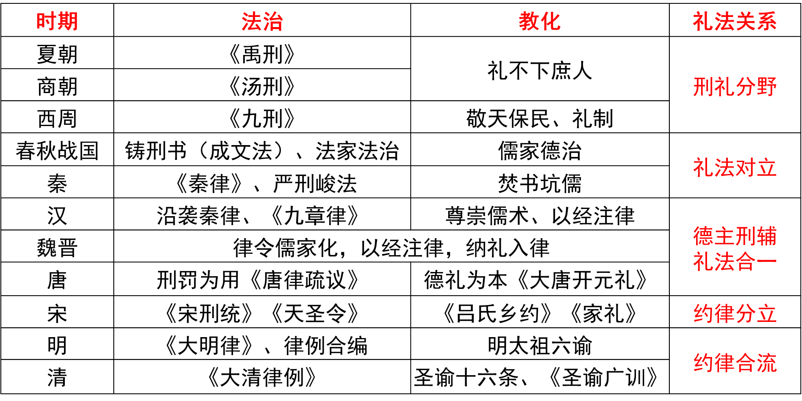

# 高中历史命题密码--古代史中国篇

[TOC]

## 精耕细作

**目的:提高单产（单位面积土地产出更多粮食）**
- 生产工具：木石骨蚌农具、铁犁牛耕、曲辕犁；
- 水利工程：都江堰、龙首渠；
- 水利工具：翻车、高转筒车；
- 耕作方法：垄作法、稻麦套作、熟制、间作套种；
- 农业技术类：生产工具、水利、育种技术；
- 因地制宜（地形）和因时制宜（节气）
- 农学农书的总结

### 例题
（2021湖南）5.宋孝宗时绍兴府赈灾，有人户状告检放秋苗不尽不实”。朱熹受命调查后发现确实存在不实，但是当时田土大多已经种麦，没有稻根可据以核查受灾面积。这反映了
A.绍兴府行政效率低下
B.理学强调实事求是的精神
C.宋代赈灾方式不合理
**D.绍兴农业精耕细作的特点**
**【答案】D**

## 商品经济
内涵定义： 自然经济:自给自足 VS 商品经济：交换（交换包括以物易物/货币媒介）

外延：
**农业方面**
- 物种交流
- 土特产交换逻辑
- 高产作物满足本地消费需要后面向外地市场
- 高产作物粮食种植面积提高和经济作物种植面积比例调整 -> 经济作物增多，农业商品化种植的程度提高

**商业方面**
- 货币、信贷、金融、贸易、契约
- 商帮、坊市制度、经济作物、农产品手工产品商业化、工商业市镇
- 重农抑商政策的放松（榷场互市、边贸）
- 白银货币化（流通）->实物税转为货币税（一条鞭法）

**法律方面**
民法（罗马法） -> 解决商业类纠纷 ->推动商品经济发展

**交通运输方面**
- 丝绸之路、新航路开辟
- 交通工具革新
- 度量衡、车轨统一（国内市场统一）

**现代**
经济全球化、世贸组织、国际货币基金组织（汇率稳定）

**其他表现**
- 西方庄园经济解体
- 中国近代以来自然经济解体（耕织分离等标志）
- 士农工商四民阶级的变动（社会流动、工商皆本思想、商人地位的提高）
- 雇佣关系、募役法、劳力服务
- 债权股权
- 资本主义萌芽、商品加工的分工生产

**土地的自由买卖并不是体现商品经济的表现 因为这并没有打破自然经济（自给自足）只是内部交换**

### 课本内容

**选必二**
不同物种的交流推动了当地经济和贸易的发展。在北美，水稻除供应本地消费外，大量用于出口，促进了对外贸易的发展。在中国，玉米等外来农作物因其高产而增加了粮食供应总量。粮食除满足生产者白身需要外，还投人市场出售，促进了**商品经济**的发展。

人类社会的商贸活动最初只是地方性行为，后扩大到国与国、洲与洲之间。丝绸之路是连接亚、欧、北非的商贸通道。货币、信贷、商业契约的出现，**是商品经济发达的表现**，便利了商品交换，扩展了商贸活动的领域。新航路开辟后，随着资本主义在全球的扩张，世界市场逐步形成。商贸活动的内容、形式都发牛了巨大变化。20世纪以来，贸易、金融现代化加速，极大地提高了商贸效率，但也增大了金融风险。


在古代中国，交换物品的场所称作“市”，通常设在人们经常集聚的地方。商朝就已经出现了专门从事**商品交换**的商人，商业贸易遍及商朝统治区城和周边地区，商业主要掌握在官府和贵展手里。春秋战国时期，“工商食官”的格局被突破。秦汉时期，货币、车轨、度量衡的统一，**促进了全国的商品流通**。从隋唐到两宋，随着商品经济的发展，城市坊市分区制度逐步瓦解，商业进一步繁荣。元、明、清时期，随着经济作物种植面积扩大和手工业的发展，农产品和手工业产品的商品化程度不断加深，形成全国范围的商业贸易网络，地域性的商人群体——商帮兴盛。(P36)

## 重农抑商政策

**历程**
**商鞅变法**    开始
**秦以后**  历代都推行
**汉初**    促进经济恢复（重农抑商）
**唐中后期两宋**   政策松动观念松动
**明清**    官方加强    
民间观念松动（民间贱商观念松动、求富观念兴起、婚姻求富观念“婚姻不问阀阅”）
**清末马关条约**    结束(放宽民间设厂限制) 清末新政（鼓励工商

**政策**
- 商业重税、限制消费、商人不得乘车，不得穿丝绸
- 商人子弟不得科举入仕
- 坊市制、盐铁专营
- 四民阶级观念、贱商观念


## 商人地位
四民地位：士农工商
商人民间地位提高（唐宋以后）
商人政治地位一直很低（官方观念不变）
商人地位有所变动（甲午中日战争后、清末新政后）

## 士农工商四民地位

1. **春秋时期：** 管仲在齐国进行变法改革时提出了“士农工商四民者”的概念，将国民分为军士、农民、工匠、商贾，没有尊卑之分

2. 尊卑之分：**秦汉（秦国）**
士最尊贵
农民次之
商人卑贱（重农抑商）不是主要剥削对象，财富资本集中壮大威胁统治

3. 士的变化：
- 春秋战国，士大夫阶层崛起、活跃
- 政治：秦朝郡县制取代分封制、军功爵制取代世卿世禄制，官僚体制确立（皇帝垂直任免各级官
吏；官僚职业化）一军士演化为官僚
- 经济：铁犁牛耕，新兴地主崛起一士阶层基本都为地主
- 文化：汉武帝尊崇儒术、汉代察举制征辟制，读书人地位的提高、士阶层的融合发展

4. 士农工商：四民结构（中国古代社会结构）、阶层之分/阶层分化/阶层流动 **（宋代发展）**
> 四民内部还可以有阶层的划分：
> - 士阶层内部士族阶层和寒门不同
> - 四民先分尊卑；
> - 士阶层内部再分尊卑：皇族亲族、士族·短暂、爵位、官员品阶

5. **清末：** 四民结构开始解体
资产阶级、无产阶级兴起
绅商阶级：地主和资产阶级混通
买办阶级：依附于列强，作为列强侵略的代理人的特殊阶级

6. **新中国：** 人人平等，四民阶级彻底解体

## 市民阶层和市民文化


## 中央集权和君主专制
先秦（秦朝以前）没有中央集权和君主专制（例外：秦国）；秦以后才有

- 中央集权：中央和地方关系（政策/措施在地方）；
- 君主专制：皇权和相权（政策/措施在中央）

中央地方别称：强干弱枝、外重内轻：干、内：中央；枝、外：地方

## 宗族/宗族观念

**历程**
1. 原始社会产生（ **父系氏族** ）
2. 商周与分封制宗法制结合（ **王侯宗族** ）
3. 宋代形成宗族制度（ **官员宗族** 、家训、家规）
4. 明清成熟（ **平民宗族** ）

**特点**
1. 以血缘为基础
2. 在家庭的基础上，以”宗“统”族“
3. 有祠堂、族长、族谱、族田等要素
4. 有社会救济的功能
5. 依附于皇权（皇权在乡村的代理人）->皇权不下县
6. 顺应忠孝伦理等主流意识
7. 自治性（有权处理内部事务）

**作用**
辅助地方官员政权，是维持地方秩序的非官方组织

## 郡国并行制

**时间**：汉初——汉武帝时期
汉武帝实行推恩令--郡国并行制名存实亡

**实行郡国并行制的原因**
历史遗留问题：异姓诸侯王、反秦起义的正义性
分封制在王朝前期有巩固新生政权作用

**恢复郡县的手段：** 剪除异性诸侯王（汉高祖）、军事平定（汉景帝）、废王侯将相或暂管、推恩令（汉武帝）、酎金夺爵、经济手段（自铸币，收回铸币权、盐铁专营权）

**分封和郡县的核心不同** 任期；向下分封；继承

## 藩镇

**历程**
**唐代 安史之乱前：**
玄宗开元年间在边境设置军镇和节度使
> 为巩固边疆，在北方、西北设置节度使，掌管数州军事，初期仅为军事防御机构，受中央严格节制

玄宗后期（唐朝中期）外重内轻

**唐代 安史之乱后：**
内地增设藩镇，节度使藩镇坐大，形成藩镇割据。

> 唐朝为平定叛乱，被迫扩大地方节度使权限，允许其自行募兵、征税以应对战乱。叛乱平定后，藩镇数量激增（全国达 40 余处），其中河北、山东等地的 “河朔三镇”（幽州、成德、魏博）率先形成割据，成为 “藩镇割据” 的典型。）

**唐朝灭亡后**
唐朝灭亡后，五代十国的割据政权多由藩镇演变而来
> 如后梁建立者朱温曾任宣武军节度使

**特点**
**职权合一**：节度使（藩镇最高长官）掌握地方军事、行政、财政、司法等核心权力
>“既有其土地，又有其人民，又有其甲兵，又有其财赋”（《新唐书》），形成 “军政财一体化” 的割据基础。

**人事自主：** 可自行任免下属官员，甚至父子相承或部将拥立
> 如 “河朔三镇” 节度使多为世袭，中央难以干预。

**军事割据：** 拥有独立武装（“牙兵”），兵力远超中央直接控制的军队，甚至公然对抗中央政令
> 如唐朝后期藩镇 “不输贡赋”“不入朝”。

**区域分异：** 并非所有藩镇都割据，唐朝藩镇可分为 “割据型”（如河朔三镇）、“防御型”（边疆抵御吐蕃等）、“财源型”（东南供应中央财赋），但 “割据型” 是导致中央失控的核心。*全国卷*

军权吞噬地方行政权（节度役使州县）

**地域** 
- 边疆中原割据严重（中央采取藩镇互相制衡）
- 东南、南方、四川相对稳定（中央控制力强）
- 四川战略地位提高（藩镇割据问题、吐蕃崛起）


## 刺史

中央斗地方：中央派遣官员监察
汉武帝设置13州刺史，巡查地方官员和豪强地主
地位：以卑临尊

**历程**
**前期：** 加强中央集权
**后期：** 监察权吞噬行政权一监察长官转为行政长官；监察区转为行政区（削弱中央集权）
**东汉晚期** 州正式成为一级行政机构，州郡县三级制，刺史行政权+领兵权
**东汉末：** 豪强一士族+地方官员•州牧+武人集团（小军阀）

## 中国古代人身关系

被控制者/控制对象：农民
控制者：国家
控制农民的原因：农民是税源
国家控制人民的方式：户籍制度/限制人口地域流动 + 阶级/职业流动
国家对农民的人身控制逐渐放松：赋税制度变化（人丁税变成田地税为主）
放松的标准：两税法

人身依附的制度：
1. **奴籍制度**：中国古代有奴籍（贱民阶层）和自由人之分
宋代  贱民阶层显著减少--社会成员趋于平等
（科举--门阀衰落/贱民阶层/商人的栓会地位提高）
家内服役：前代世袭奴婢（依附主家），宋代开始变成雇佣关系（文化称呼）

2. **租佃关系**：地主对农民有人身控制
汉代田庄经济：人身依附关系强（世代居住，终生不离）
宋代佃户人身依附减弱——较少受到契约以外的人身依附关系束缚
魏晋南北朝：坞堡制（民兵组织）

## 坞堡制度

**时间**：魏晋南北朝
**实质**： 
- 特定动荡环境下豪强崛起、中央权威衰落形成的特殊社会组织形态。
- 坞堡是 “军事防御 + 生产生活 + 宗族凝聚” 的复合型组织

**历史背景**
**战乱频发，社会秩序崩溃：** 东汉末年黄巾起义动摇了中央对地方的控制，随后的 “董卓之乱”“八王之乱”“永嘉之乱” 等持续战乱，导致原有的郡县基层治理体系彻底瓦解，百姓为躲避兵灾、劫掠，被迫寻求庇护。
**中央权威衰落，地方失控：** 魏晋南北朝时期，统一政权短暂，中央政府无力对地方实施有效管辖，为地方势力自主组织防御提供了空间。
**豪强士族势力壮大：** 西汉以来的土地兼并在东汉后期加剧，豪强地主通过宗族关系、经济实力（占有大量土地和依附农民）形成地方势力，具备组织武装、修建防御工事的能力，成为坞堡的主导者。

**特点**
1. 防御性突出（依托险要地形）
2. 具有自给自足的封闭性
3. 是以宗族为核心的依附关系
   > 主导者多为地方豪强或士族（如坞堡主），成员以宗族子弟为核心，辅以流民、依附农民（“佃客”“徒附”），形成 “主 — 仆” 式的人身依附关系，坞堡主兼具军事领袖、管理者和经济支配者的角色。
4. 独立性强

## 赋税制度的演变

### 先秦至秦汉

**夏商周：** 贡赋制度（诸侯按土地等级向天子进贡特产）

**秦朝：** “黔首自实田”
按土地数量征收田赋，并开征人头税（户赋、口赋）。

**春秋战国** 编户齐民（户籍制度）与赋税制度相结合

**汉朝：** 汉承秦制，田赋从“十五税一” 降至 “三十税一”，但人头税（算赋、口赋）和徭役负担沉重。

> **背景：** 铁器牛耕推广推动农业生产力提升，土地私有制取代井田制，中央集权国家需稳定财政支撑官僚体系与军事扩张。
> **影响：** 编户齐民制度强化了国家对人口的控制，但过度依赖人头税导致农民逃亡，为魏晋南北朝的坞堡割据埋下隐患。

### 魏晋南北朝 =租调制
北魏孝文帝改革后：租调制
采取“三长制”取代豪强主导的“宗主督护制”，清查隐匿人口以增加赋税。

> **背景** 长期战乱导致人口锐减、土地荒芜，豪强坞堡隐匿人口，国家财政面临崩溃。
> **影响** 均田制和组调制推动北方发展，但未能阻止土地兼并（世业田），为唐代的租庸调制奠定基础。

### 唐代 租佣调制和两税法

- 租庸调制 以均田制为基础，每丁年纳粟 2 石（租）、绢 2 丈（调），并服劳役 20 天（庸），可纳绢代役
- 两税法 780 年杨炎推行，按土地和资产分夏秋两季征税，取消人头税。

> **背景：** 均田制崩溃后，租庸调制无法维持，安史之乱导致中央财政枯竭，藩镇截留税收加剧危机。
> **影响：** 两税法标志着中国赋税从 “税人” 转向 “税地”，减轻了无地农民负担，但允许地方按最高税额征收，反而加重了百姓困苦。

### 宋代

王安石变法推行 “方田均税法”，重新丈量土地以打击隐匿田产；“募役法” 将差役改为按户等征收免役钱，官僚地主亦需缴纳。

> **背景：** 宋代 “不抑兼并” 政策导致土地高度集中，“三冗” 问题（冗兵、冗官、冗费）使财政陷入困境。
> **影响：** 短期增加了财政收入，但触犯了豪强利益，最终因保守派反对而失败。

### 明代：一条鞭法与货币税

1581 年张居正推行 “一条鞭法”，将田赋、徭役、杂税合并为征收银两，按亩折算缴纳。

> **背景：** 商品经济发展推动白银货币化，土地兼并导致农民逃亡，政府需简化税制以提高效率。
> **影响：** 促进了农产品商品化和雇佣劳动的发展，但白银外流和地方加派使农民实际负担加重。

### 清代：摊丁入亩
1712 年康熙颁布 “滋生人丁永不加赋”，1723 年雍正推行 “摊丁入亩”，将丁银摊入田赋统一征收。

> **背景：** 明末农民起义暴露了人头税的弊端，清初土地兼并严重，政府需稳定税源。
> **影响：** 彻底废除了延续 2000 年的人头税，农民人身依附关系松弛，推动人口从 1741 年的 1.4 亿激增至 1840 年的 4.1 亿。但土地兼并加剧，自耕农数量减少。

### 民国时期：田税附加和关税主权丧失

田赋：正税包括地租、三费、经征费，附加捐名目繁多（如省防费、警备费），税率高达正税的数倍。
关税：《南京条约》后中国丧失关税自主权，海关被列强控制，进口税率长期低于 5%。

> **背景：** 军阀割据导致地方政府随意加税，半殖民地化使国家财政受制于列强。
> **影响：** 田赋附加榨干农民血汗，关税流失削弱了民族工业竞争力，加剧了经济凋敝。


### 新中国成立初期：农业税与计划经济
1958 年颁布《农业税条例》，按常年产量的 15% 左右征收实物（公粮），并附加地方税。

> **背景：** 工业化初期需要农业为工业积累资金，计划经济体制下税收服务于国家战略。
> **影响：** 保障了工业化原始积累，但长期制约了农村发展。

### 2006 年：农业税的终结
2005 年 12 月全国人大废止《农业税条例》，2006 年 1 月 1 日起全面取消农业税。

> **背景：** 农业占 GDP 比重降至 12% 以下，城乡差距扩大倒逼政策调整。
> **影响：** 减轻农民负担约 1200 亿元 / 年，推动了社会主义新农村建设，但也削弱了基层财政。

### 税制改革：增值税与现代化转型
分税制：1994 年确立中央与地方分税体系，增值税成为主体税种。
营改增：2016 年将营业税并入增值税，消除重复征税，税率简并为 6%、11%、17% 三档。
增值税立法：2024 年《增值税法》通过，2026 年起施行，标志着税收法治化进程。

> **背景：** 市场经济发展要求统一税制，国际竞争推动税收与国际接轨。
> **影响：** 增值税覆盖全产业链，2023 年贡献税收收入 6.2 万亿元（占总税收 36%），成为国家财政的核心支柱。


## 君主专制：皇权和相权的关系（四）（五）

## 关陇集团

**概念：** 以关陇、河东地区为核心，由鲜卑军事贵族与汉族豪强通过军事合作、政治联姻形成的利益共同体的统称。

## 儒学地位的演变

## 中国古代思想（暂定）

### 民本思想
1. **概念**： 在人与自然的关系中，突出人的地位；在社会关系方面，强调民的作用。

2. **历程**
    **开始**： 发端于西周：西周统治者从重神观念向重人观念的转变
    **发展**： 孔子孟子的“仁”与“仁政”思想
    **后续**： 历朝历代治国思想（非主导、主流）部分时期；中国历史上国家治理比较好的时期，也是民本思想受到重视的时期。

3. **和民主思想的对比**：实质不同
   封建社会民本思想目的维护君主专制、重视民众（权力在君）
   近代社会民主思想：主权在民


### 天人合一思想
1. 中国文化的基本特征之一

2. 历程
    - **夏商时期** 相信上天和鬼神（敬畏自然）
    - **春秋时期** 老子哲学思想体现“天人合一”（顺应自然）
    > "人法地、地法天、天法道、道法自然“
    - **战国时期** 荀子“天行有常”（尊重自然）
      利用自然/发挥主观能动性，利用规律
    荀子、老子关于天人合一思想——**朴素唯物观**
3. 天人合一思想体现：人与自然和谐共生——合理利用自然资源
   
### 中国古代天命观
**核心内涵：** 天作为宇宙最高主宰，拥有赋予或剥夺人间统治权的权威；君主的统治合法性源于 “天命”。
**作用：** 解释政权合法性、规范君主行为
**具体内容**
1. **天人关系** 天——生产力低下时期对自然规律代化
2. **天命观** 命运论（超自然力量决定了人（帝王）的命运，无法改变不可抗拒，不承认主观能动性）
    > 体现：夏商时期崇拜鬼神
3. **天人合一思想：** 老子、荀子
    - 顺应自然并尊重自然，和谐发展，利用自然
    - 承认主观能动性，人尊重自然规律的前提下可以改变人生，决定自己的命运
    - 摒弃了天命的绝对权威
4. 天人感应思想
    君主利用天命观、天人合一思想，宣扬君权神授
    `阴阳家` `五德始终`等理念 超自然力量决定万事万物的发展
    天命后来由命运论 -> 德 个人修养

**天人感应思想演变历程** 
天命观的雏形萌发于商代，在周代完成体系化，成为早期国家构建统治合法性的核心工具。
1. **商代：** “帝命” 与神权垄断
    内容：商代尚未形成 “天” 的核心地位，更强调 “帝”（至上神）的权威。商王认为自己是 “帝” 的后裔，通过祖先神与 “帝” 沟通，**“帝命” 是统治权的唯一来源，且具有永恒性** 。
    > 商纣王曾言 “我生不有命在天？”，认为天命不可动摇

    特点：天命与血缘绑定，缺乏 “德行” 约束，具有绝对化、不可挑战的色彩。

2. **周代：** “天命靡常，惟德是辅”（关键转型）
    内容：周灭商后，周公提出全新天命观：
    **天命并非永恒专属某一族群（“天命靡常”），而是 “惟德是辅”—— 天只保佑有德行的君主；**
    商王因 “失德”（暴虐、失民心）丧失天命，周王因 “明德慎罚”“保民” 获得天命。


3. **秦汉：** “君权神授” 与 “五德终始说”
    **秦始皇：** 通过 “皇帝” 称号（“德兼三皇，功过五帝”）将自己神化，宣称 “受命于天，既寿永昌”，强化天命与皇权的直接绑定。
    **汉武帝：** 采纳董仲舒 “天人感应” 理论，将天命观系统化：
    > 天通过祥瑞（如凤凰、甘露）表彰明君，通过灾异（如地震、蝗灾）警示失德君主；君主需 “屈民而伸君，屈君而伸天”，即天成为约束皇权的 “虚拟权威”。
    
    **五德终始说：** 邹衍提出的 “五行相胜” 理论被吸纳，认为每个王朝对应一种 “德”（如秦为水德、汉为火德），德运更替即天命转移，为王朝更替提供 “自然规律” 依据。


4. **隋唐：** “天命在民” 的延续与科举制的影响
    唐太宗强调 “君，舟也；民，水也。水则载舟，水则覆舟”，将 “民心” 视为天命的直接体现，进一步强化 “保民即保天命” 的逻辑。

5. **宋明：** 理学对天命观的哲学化改造
    程朱理学将 “天” 解释为 “理”（宇宙本源与道德法则），“天命” 即 “理” 在人间的体现，君主需 “存天理，灭人欲” 以符合天命。
    陆王心学则强调 “心即理”，认为 “天命” 与 “人心” 相通，君主的 “仁心” 是维系天命的核心，弱化了天的神秘性，更注重内在道德自觉。

6. **明清：** 天命观的绝对化与危机
    明清君主进一步强化 “君权神授”，如朱元璋称 “奉天承运皇帝”，康熙强调 “天视自我民视，天听自我民听”

7. **晚清至民国：** 天命观的瓦解
    西方民主、科学思想传入，“君权神授” 受到批判（如戊戌变法主张 “兴民权”，辛亥革命推翻帝制）；传统天命观被视为 “封建糟粕”，逐渐退出政治舞台.


## 血缘政治和官僚政治（家国同构）

## 中国古代法治和教化



### 社会教化

#### 社会教化方式的演变
1. **春秋战国：** 儒法之争——儒家主张通过道德礼义教化民众；法家：韩非主张“以法为教”“以吏为师”
2. **唐朝**：提倡礼治。家训强化基层教化
   > 732年，唐朝政府颁行《大唐开元礼》。《大唐开元礼》分吉、宾、军、嘉、凶五礼，是一部体系庞大、体例严谨、内容繁复的礼仪法典，也是秦汉以来封建礼仪制度的集大成。
   > 在社会层面，唐朝政府推广魏晋南北朝以来重视家训的经验，强化基层教化

3. 宋朝：儒学向基层渗透
    背景：魏晋至唐儒学社会影响力不如佛道
    > **宋朝儒学开始向基层渗透**，并发展出理学理学控制教育与科举，并通过授徒、书院讲学等方式在社会上广泛传播，甚至深入族规之中。朱熹的 **《家礼》** 和 **《小学》** 也成为家庭和幼童的行为规范。

#### 例题
（2018年全国一卷第41题第（1）问）
```text
材料：宋代一些地方实行乡约制度，其功能主要是扬善惩恶，
制定规约进行道德教化，并建立民间组织和相关的赏罚，明清
时期，宣讲“圣谕”成为乡约最重要的内容。当时，由地方官吏
广泛推行乡约制度，设立乡约组织，每月召集百娃宣讲，教化，
康熙九年颁布了乡约组织必须宣讲的《上谕十六条》，内容包
含“重农桑以足衣食”“训子弟以禁非为”等。
                        ——据杨开道《中国乡约制度》等
```
**根据材料并结合所学知识，概括宋代到明清时期乡约制度的变化，并说明乡约制度的积极作用。**

（1）变化：
①宋以道德教化为主，明清增加了宣讲“圣谕”的内容；
②乡约组织从民间自发建立到由地方官吏推动设立。
（2）积极作用：
①有利于维护社会秩序，加强基层社会治理；
②有利于发展生产；
③促进了儒家文化和传统道德的传播。


### 乡约和法律合流
- **明清·乡约法律合流：** 原本由儒学士人发起的教化百姓的乡约，经政府利用和推广而具有约束力，与法律合流
- **北宋** 吕大钧兄弟是乡约的创造者；**《吕氏乡约》**（自治·民间拟定；自觉遵守）
- **明朝后期**，乡约改为宣讲明太祖朱元璋的“六谕”。六谕主劝谕，但也有禁约成分，使乡约逐渐带有强制力；不遵乡约的百姓要受到处罚，甚至送官府治罪（必须遵守·行政强制力；宣讲圣谕，引用律例）
- **清朝** 乡约基本延续了明朝的模式：但宣讲内容变成了康熙帝“圣谕十六条”和雍正帝《圣谕广训》，引用《大清律例》宣讲圣谕无法体现乡约法律合流；政府利用推广（强制力：处罚）体现乡约法律合流.